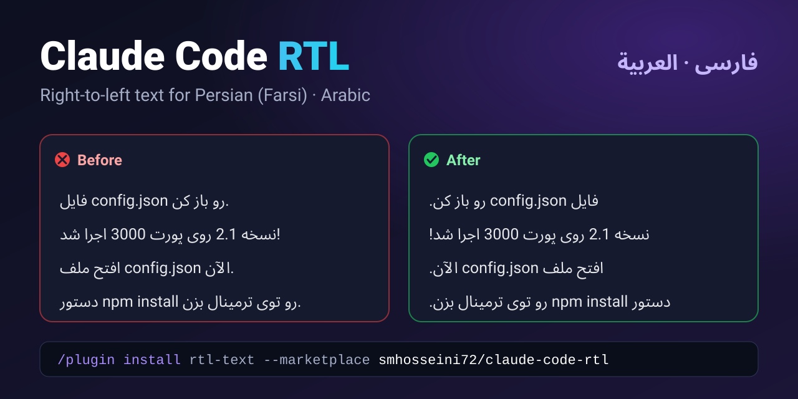
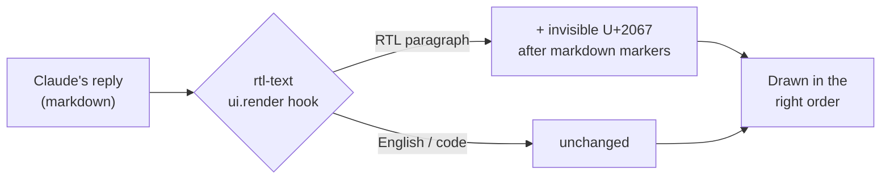

<p align="center">
  
</p>

<h1 align="center">Claude Code RTL</h1>

<p align="center" dir="rtl">
  <b>پشتیبانی راست‌به‌چپ (RTL) برای Claude Code</b><br>
  بالاخره فارسی، عربی و عبری به ترتیب درست خونده میشن، حتی وقتی وسطشون انگلیسی، کد، اسم فایل و عدد باشه.
</p>

<p align="center">
  <a href="https://github.com/smhosseini72/claude-code-rtl/actions/workflows/ci.yml"></a>
  <a href="https://github.com/smhosseini72/claude-code-rtl/releases"></a>
  
  <a href="LICENSE"></a>
  <a href="https://github.com/smhosseini72/claude-code-rtl/stargazers"></a>
</p>

<p align="center">
  <a href="README.md">English</a> · <b>فارسی</b>
</p>

---

<div dir="rtl">

## مشکل چیه؟

Claude Code همه‌ی پاراگراف‌ها رو چپ‌به‌راست می‌چینه. برای زبون‌های راست‌به‌چپ این یعنی جمله‌ها از سه جا بهم می‌ریزن:

- نقطه، علامت سؤال یا علامت تعجب می‌پره اون طرف جمله؛
- یه کلمه‌ی انگلیسی مثل `config.json` یا `npm install` جمله رو دو تیکه می‌کنه و جای تیکه‌ها عوض میشه؛
- عددها و شماره‌ی نسخه‌ها جابه‌جا میشن.

همه‌ی کلمه‌ها هستن، ولی باید تیکه‌تیکه بخونیشون. **Claude Code RTL** ترتیب رو درست می‌کنه تا جواب‌های Claude و پیام‌های خودت مثل یه متن معمولی خونده بشن.

## ویژگی‌ها

- 🌍 **فارسی، عربی و عبری**، و بقیه‌ی زبون‌هایی که با همین خط‌ها نوشته میشن: اردو، کردی سورانی، پشتو و...
- 🔀 **متن ترکیبی، درست**: کلمه‌های انگلیسی، کد، اسم فایل، عدد و لینک سر جای خودشون می‌مونن
- 📝 **آشنا با Markdown**: تیتر، لیست، چک‌لیست، نقل‌قول و خونه‌های جدول؛ به بلوک‌های کد هیچ‌وقت دست نمی‌زنه
- 💬 **هر دو طرف گفتگو**: هم جواب‌های Claude، هم پیام‌های خودت
- 👀 **فقط نمایش**: گفتگوی ذخیره‌شده و چیزی که Claude می‌خونه هیچ‌وقت عوض نمیشه
- 🎚️ **روشن و خاموش با یه دستور**: `/rtl`، و انتخابت یادش می‌مونه
- 🔒 **کوچیک و امن**: حدود ۱۹۰ خط TypeScript، بدون وابستگی، بدون اینترنت، بدون دسترسی به فایل‌ها، بدون جمع‌آوری داده
- 💻 **مک، ویندوز و لینوکس**، با تست خودکار روی هر سه

## نصب

**پیش‌نیاز:** Claude Code نسخه‌ی **2.1.295 یا جدیدتر** (با `claude --version` چک کن و با `claude update` آپدیت کن).

روی **مک، ویندوز و لینوکس** دستور یکیه. توی یه session ترمینالی Claude Code بنویس:

</div>

```text
/plugin install rtl-text --marketplace smhosseini72/claude-code-rtl
```

<div dir="rtl">

برای اضافه شدن marketplace جواب `y` رو بده، بعد سطح **user** رو انتخاب کن.

یا از هر ترمینالی (Terminal، iTerm2، PowerShell، Windows Terminal، bash، zsh):

</div>

```bash
claude plugin install rtl-text --marketplace smhosseini72/claude-code-rtl
```

<div dir="rtl">

> **از اپ دسکتاپ Claude استفاده می‌کنی؟** یه بار از ترمینال با دستور بالا نصبش کن. تب Code اپ توی همه‌ی sessionهای جدید خودش لودش می‌کنه.

</div>

<details>
<summary dir="rtl"><b>آپدیت، حذف، یا نصب از یه کپی محلی</b></summary>

```bash
# update to the latest version
claude plugin update rtl-text@claude-code-rtl

# uninstall
claude plugin uninstall rtl-text@claude-code-rtl

# install from a local clone (for development)
git clone https://github.com/smhosseini72/claude-code-rtl.git
claude plugin install rtl-text --marketplace ./claude-code-rtl
```

</details>

<div dir="rtl">

## استفاده

هیچ تنظیمی لازم نیست: بعد از نصب، پاراگراف‌های راست‌به‌چپ همون موقع که نمایش داده میشن درست میشن. برای مقایسه یا خاموش کردن:

| دستور      | کارش                                         |
| ---------- | -------------------------------------------- |
| `/rtl`     | روشن یا خاموش کردن نمایش راست‌به‌چپ          |
| `/rtl on`  | روشن کردن                                    |
| `/rtl off` | خاموش کردن (برای مقایسه‌ی قبل و بعد عالیه)   |

## کجا کار می‌کنه؟

| کجا                          | وضعیت                                                                     |
| ---------------------------- | ------------------------------------------------------------------------- |
| اپ دسکتاپ Claude (تب Code)   | ✅ کار می‌کنه                                                              |
| افزونه‌ی VS Code              | 🧪 احتمالاً کار می‌کنه، هنوز تست نشده                                     |
| ترمینال (CLI)                | ➖ دست نمی‌زنه: توی ترمینال، راست‌به‌چپ به پشتیبانی bidi خود ترمینال بستگی داره |

## چطوری کار می‌کنه؟

</div>



<div dir="rtl">

1. قبل از اینکه یه پیام نمایش داده بشه، پلاگین تک‌تک خط‌هاش رو نگاه می‌کنه. یه خط راست‌به‌چپ حساب میشه اگه اولین حرفش راست‌به‌چپ باشه، یا تعداد حروف راست‌به‌چپش حداقل اندازه‌ی حروف لاتینش باشه. کد، لینک و آدرس اینترنتی حساب نمیشن.
2. برای هر خط راست‌به‌چپ، یه کاراکتر نامرئی یونیکد به اسم **RIGHT-TO-LEFT ISOLATE (U+2067)** درست بعد از علامت‌های Markdown (`#`، `-`، `1.`، `>`، `[x]`) اضافه می‌کنه.
3. بعد نمایش‌دهنده اون پاراگراف رو راست‌به‌چپ می‌چینه، و علامت‌ها، کلمه‌های انگلیسی و عددها همون جایی میشینن که خواننده انتظار داره.

بلوک‌های کد رد میشن، و خط‌هایی که از قبل یه علامت جهت دارن همون‌طور که هستن می‌مونن. کد کوتاه و خواناست: [`hooks/bidi.ts`](https://github.com/smhosseini72/claude-code-rtl/blob/main/hooks/bidi.ts) و [`hooks/register.ts`](https://github.com/smhosseini72/claude-code-rtl/blob/main/hooks/register.ts).

## «ماد» (mod) یعنی چی؟

**پلاگین‌های** Claude Code بسته‌هایی هستن که از یه marketplace نصب میشن. می‌تونن اسلش‌کامند، اسکیل، agent، سرور MCP و هوک اضافه کنن.

**ماد** پلاگینیه که یه ماژول کوچیک TypeScript داره و Claude Code اون رو داخل خودش اجرا می‌کنه. واسه همین می‌تونه ظاهر خود Claude Code رو عوض کنه: یه پیام رو از نو نمایش بده، یا یه پنل، status line یا دستور جدید اضافه کنه.

`rtl-text` هر دوئه: مثل هر پلاگینی نصب میشه، و مثل یه ماد پیام‌های گفتگو رو از نو نمایش میده. ماد هنوز یه قابلیت آزمایشی (early access) توی Claude Code هست و API اون ممکنه بین نسخه‌ها عوض بشه.

## محدودیت‌ها

- **چینش:** ترتیب خط‌های راست‌به‌چپ درست میشه ولی سمت چپ می‌مونن. ماد با المان‌های خود Claude Code نمایش میده و اون‌ها CSS مثل `text-align` یا `dir` قبول نمی‌کنن.
- **فونت و اندازه‌ی فونت:** ماد نمی‌تونه عوضشون کنه. توی اپ دسکتاپ از زوم استفاده کن: <kbd>Cmd</kbd>/<kbd>Ctrl</kbd> + <kbd>=</kbd> / <kbd>-</kbd>.
- **جدول‌ها:** ترتیب ستون‌ها چپ‌به‌راست می‌مونه، ولی متن داخل هر خونه درست میشه.
- **ترمینال:** دست نمی‌خوره، بالاتر توضیح دادم.

## سؤال‌های رایج

</div>

<details>
<summary dir="rtl"><b>چیزی که Claude می‌بینه یا ذخیره میشه رو عوض می‌کنه؟</b></summary>
<div dir="rtl">

نه. پلاگین فقط نسخه‌ای از متن رو که داره نمایش داده میشه بازنویسی می‌کنه. گفتگوی ذخیره‌شده و ورودی مدل دست‌نخورده می‌مونن.

</div>
</details>

<details>
<summary dir="rtl"><b>نصبش امنه؟</b></summary>
<div dir="rtl">

حدود ۱۹۰ خط TypeScript بدون هیچ وابستگیه. به اینترنت وصل نمیشه، فایلی نمی‌خونه و چیزی جمع نمی‌کنه. تنها چیزی که ذخیره می‌کنه یه مقدار روشن/خاموش برای `/rtl` هست.

</div>
</details>

<details>
<summary dir="rtl"><b>چرا از <code>dir="auto"</code> استفاده نکردی؟</b></summary>
<div dir="rtl">

برای یه صفحه‌ی وب راه درست همونه، ولی ماد نمی‌تونه توی Claude Code ویژگی HTML یا CSS تنظیم کنه. کاراکتر isolate یونیکد همون ترتیب خوندن رو میده، بدون اینکه لازم باشه خود اپ دستکاری بشه.

</div>
</details>

<details>
<summary dir="rtl"><b>Claude Code رو کند نمی‌کنه؟</b></summary>
<div dir="rtl">

نه. فقط موقع نمایش هر پیام یه بار سریع متنش رو مرور می‌کنه.

</div>
</details>

<div dir="rtl">

## توسعه

</div>

```bash
claude plugin validate .   # manifest, marketplace and hooks module
claude plugin test .       # unit tests and render tests
```

<div dir="rtl">

مشارکت با کمال میل پذیرفته میشه، مخصوصاً نمونه‌هایی از متن که هنوز درست نمایش داده نمیشه. راهنما: [CONTRIBUTING.md](CONTRIBUTING.md).

## ⭐ حمایت از پروژه

اگه Claude Code RTL باعث شد Claude به زبون خودت خوندنی بشه، **لطفاً به ریپو ستاره بده** ⭐.
فقط یه کلیکه و کمک می‌کنه بقیه‌ی فارسی‌زبون‌ها، عرب‌زبون‌ها و عبری‌زبون‌ها هم پیداش کنن. اگه با دوستات یا توی شبکه‌های اجتماعی هم به اشتراکش بذاری، خیلی کمک می‌کنه.

</div>

<p align="center">
  <a href="https://star-history.com/#smhosseini72/claude-code-rtl&Date">
    
  </a>
</p>

<div dir="rtl">

## مجوز

[MIT](LICENSE) © mahdi ([@smhosseini72](https://github.com/smhosseini72))

</div>

---

<sub dir="rtl"><b>کلیدواژه‌ها:</b> راست‌به‌چپ کلاد کد · کلاد کد فارسی · فارسی در Claude Code · پشتیبانی RTL برای Claude · متن فارسی بهم‌ریخته در Claude · Claude Code RTL · Claude Code Persian · Claude Code Farsi · Claude Code Arabic · Claude Code Hebrew · Claude Code بالعربية · Claude Code בעברית</sub>
