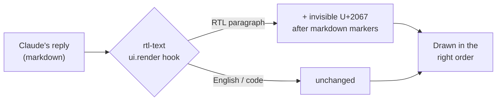

<p align="center">
  
</p>

<h1 align="center">Claude Code RTL</h1>

<p align="center">
  <b>Right-to-left (RTL) support for Claude Code.</b><br>
  Persian (Farsi), Arabic and Hebrew finally read in the right order, even when mixed with English, code, file names and numbers.
</p>

<p align="center">
  <a href="https://github.com/smhosseini72/claude-code-rtl/actions/workflows/ci.yml"></a>
  <a href="https://github.com/smhosseini72/claude-code-rtl/releases"></a>
  
  <a href="LICENSE"></a>
  <a href="https://github.com/smhosseini72/claude-code-rtl/stargazers"></a>
</p>

<div align="center">

**English** · [فارسی](README.fa.md)

</div>

---

## The problem

Claude Code lays out every paragraph left-to-right. In a right-to-left language that breaks sentences in three ways:

- the period, question mark or exclamation mark lands on the wrong side of the sentence;
- an English word such as `config.json` or `npm install` cuts the sentence in two and swaps the halves;
- numbers and version strings jump to the wrong place.

All the words are there, but you end up reading them in pieces. **Claude Code RTL** fixes the order, so Claude's replies and your own prompts read like normal text.

## Features

- 🌍 **Persian (Farsi), Arabic and Hebrew**, plus other languages in those scripts: Urdu, Kurdish (Sorani), Pashto and more
- 🔀 **Mixed text done right**: English words, code, file names, numbers and URLs stay where they belong
- 📝 **Markdown-aware**: headings, lists, checklists, quotes and table cells; code blocks are never touched
- 💬 **Both sides of the chat**: Claude's replies and your prompts
- 👀 **Display only**: the saved conversation and what Claude reads are never changed
- 🎚️ **One command to toggle**: `/rtl`, and your choice is remembered
- 🔒 **Tiny and safe**: about 190 lines of TypeScript, no dependencies, no network, no file access, no telemetry
- 💻 **macOS, Windows and Linux**, with CI on all three

## Install

**Requires** Claude Code **v2.1.295 or newer** (`claude --version`; update with `claude update`).

The same command works on **macOS, Windows and Linux**. In a Claude Code terminal session, type:

```text
/plugin install rtl-text --marketplace smhosseini72/claude-code-rtl
```

Answer `y` to add the marketplace, then choose the **user** scope.

Or from any shell (Terminal, iTerm2, PowerShell, Windows Terminal, bash, zsh):

```bash
claude plugin install rtl-text --marketplace smhosseini72/claude-code-rtl
```

> **Using the Claude desktop app?** Install once from a terminal as shown above. The app's Code tab loads the plugin in every new session.

<details>
<summary><b>Update, uninstall, or install from a local clone</b></summary>

```bash
# update to the latest version
claude plugin update rtl-text@claude-code-rtl

# uninstall
claude plugin uninstall rtl-text@claude-code-rtl

# install from a local clone (for development)
git clone https://github.com/smhosseini72/claude-code-rtl.git
claude plugin install rtl-text --marketplace ./claude-code-rtl
```

</details>

## Usage

Nothing to configure: once installed, RTL paragraphs are fixed as they appear. To compare or switch off:

| Command    | What it does                         |
| ---------- | ------------------------------------ |
| `/rtl`     | Toggle RTL display                   |
| `/rtl on`  | Turn it on                           |
| `/rtl off` | Turn it off (handy for a before/after) |

## Where it works

| Where                         | Status                                                                                   |
| ----------------------------- | ---------------------------------------------------------------------------------------- |
| Claude desktop app (Code tab) | ✅ Works                                                                                  |
| VS Code extension             | 🧪 Expected to work, not tested yet                                                      |
| Terminal (CLI)                | ➖ Left alone: in a terminal, RTL depends on the terminal app's own bidi support          |

## How it works



1. Before a message is drawn, the plugin looks at each line. A line with Persian, Arabic or Hebrew letters is right-to-left when its first or last letter is RTL, when at least half its words are RTL, or when it uses Persian/Arabic digits or punctuation (`۱۲۳`, `،`, `؟`). So a sentence like "PR ۱: merge شد" counts too, even though it opens in English. Code spans, URLs and link targets don't count.
2. For an RTL line it inserts one invisible Unicode character, **RIGHT-TO-LEFT ISOLATE (U+2067)**, just after any markdown markers (`#`, `-`, `1.`, `>`, `[x]`). After a colon or Persian comma that ends an English word it adds a **RIGHT-TO-LEFT MARK (U+200F)**, so "PR ۱:" and "merge" stay two separate pieces instead of fusing into one English run. Signed numbers (`-5`, `+2.5%`) and phone numbers in spaced groups (`+98 912 123 4567`) go in a **LEFT-TO-RIGHT ISOLATE (U+2066 … U+2069)**, so they don't come out as "5-" or with their groups reversed.
3. The renderer then orders that paragraph right-to-left, so punctuation, English words and numbers land where a reader expects.

Fenced code blocks are skipped, and lines that already start with a bidi mark are left as written. The source is short and readable: [`hooks/bidi.ts`](https://github.com/smhosseini72/claude-code-rtl/blob/main/hooks/bidi.ts) and [`hooks/register.ts`](https://github.com/smhosseini72/claude-code-rtl/blob/main/hooks/register.ts).

## What is a mod?

Claude Code **plugins** are packages you install from a marketplace. They can add slash commands, skills, agents, MCP servers and hooks.

A **mod** is a plugin that ships a small TypeScript module which Claude Code runs inside itself, so it can change Claude Code's own interface: redraw a message, or add a panel, a status line or a command.

`rtl-text` is both. You install it like any plugin, and it works as a mod that redraws transcript messages. Mods are an early-access feature of Claude Code, so their API may change between releases.

## Limitations

- **Alignment:** RTL lines are ordered correctly but stay left-aligned. Mods draw with Claude Code's own elements, which don't take CSS such as `text-align` or `dir`.
- **Fonts and font size:** a mod can't change them. In the desktop app, use zoom: <kbd>Cmd</kbd>/<kbd>Ctrl</kbd> + <kbd>=</kbd> / <kbd>-</kbd>.
- **Tables:** columns stay in left-to-right order. The text inside each cell is fixed.
- **Code blocks:** never touched, Persian comments included. Copied code must stay free of invisible characters: Rust refuses bidi characters in comments and GCC warns about them (the "Trojan Source" defense).
- **Terminal:** left alone, see above.

## FAQ

<details>
<summary><b>Does it change what Claude sees or what is saved?</b></summary>

No. The plugin only rewrites the copy of the text that is about to be drawn. The stored conversation and the model's input are untouched.
</details>

<details>
<summary><b>Is it safe to install?</b></summary>

It is about 190 lines of TypeScript with no dependencies. It makes no network requests, reads no files and collects nothing. All it stores is one on/off value for `/rtl`.
</details>

<details>
<summary><b>Why not just use <code>dir="auto"</code>?</b></summary>

That is the right fix for a web page, but a mod can't set HTML attributes or CSS in Claude Code. A Unicode isolate gives the same reading order without patching or repackaging the app.
</details>

<details>
<summary><b>Does it slow Claude Code down?</b></summary>

No. It does one quick text pass per message when the message is drawn.
</details>

## Development

```bash
claude plugin validate .   # manifest, marketplace and hooks module
claude plugin test .       # unit tests and render tests
```

```text
.claude-plugin/
  plugin.json        plugin manifest
  marketplace.json   makes this repo installable with one command
hooks/
  register.ts        the mod: /rtl command and the ui.render hooks
  bidi.ts            direction detection and markdown-aware marking
tests/rtl.test.ts    unit and render tests
types/index.d.ts     state contract
```

Contributions are welcome, especially examples of text that still renders wrong. See [CONTRIBUTING.md](CONTRIBUTING.md).

## ⭐ Support the project

If Claude Code RTL made Claude readable in your language, **please give the repo a star** ⭐.
It takes one click and helps other Persian, Arabic and Hebrew speakers find it. Sharing it with a friend or on social media helps too.

<p align="center">
  <a href="https://star-history.com/#smhosseini72/claude-code-rtl&Date">
    
  </a>
</p>

## License

[MIT](LICENSE) © mahdi ([@smhosseini72](https://github.com/smhosseini72))

---

<sub><b>Keywords:</b> Claude Code RTL · Claude Code right-to-left · Claude Code Persian · Claude Code Farsi · Claude Code Arabic · Claude Code Hebrew · Claude desktop RTL · bidi · bidirectional text · Claude Code plugin · Claude Code mod · راست‌به‌چپ کلاد کد · کلاد کد فارسی · Claude Code بالعربية · Claude Code בעברית</sub>
